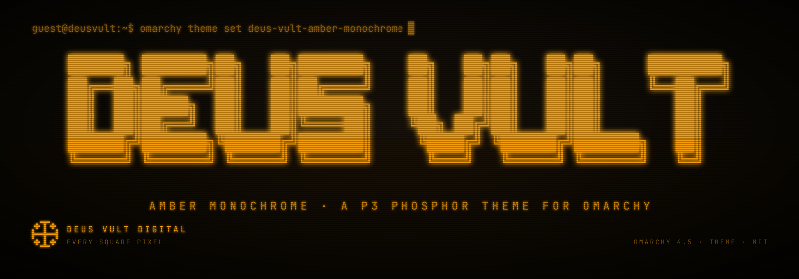
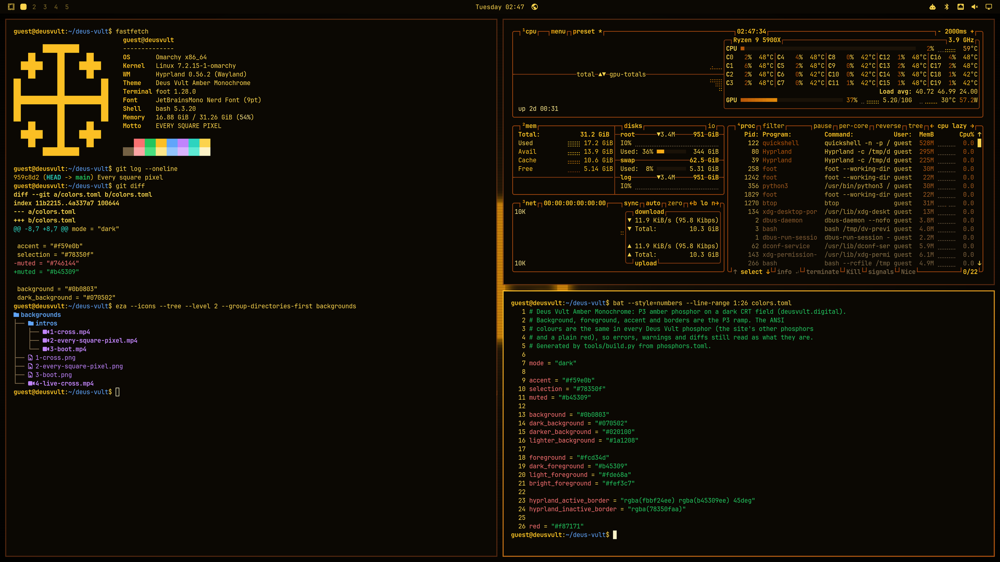
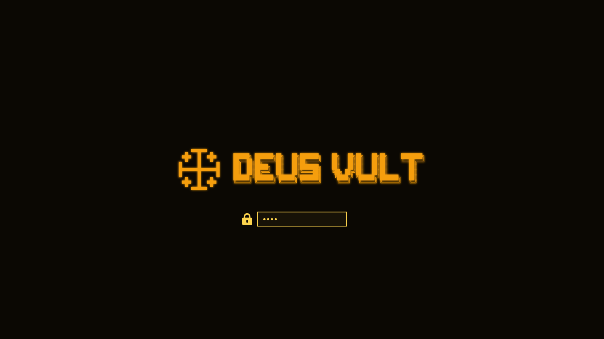

<h1 align="center"></h1>

<p align="center">
  Omarchy 4.5 theme · by <a href="https://deusvult.digital">Deus Vult Digital</a>
</p>

<p align="center">
  <a href="#install">Install</a> ·
  <a href="#whats-in-it">What's in it</a> ·
  <a href="#palette">Palette</a> ·
  <a href="#the-other-phosphors">The other phosphors</a> ·
  <a href="#license">License</a>
</p>

<p align="center">
  
</p>

P3 amber phosphor on a dark CRT field: the glow of an old amber
monochrome terminal, kept quiet enough to work in all day. Errors, warnings and diffs
keep their own colours (red, amber, green, blue), so the terminal still tells
you what's what. One of four Deus Vult phosphor themes, after the phosphors of
[deusvult.digital](https://deusvult.digital).

## Install

```sh
omarchy theme install https://github.com/deus-vult-digital/omarchy-deus-vult-amber-monochrome-theme.git
```

The installer clones the theme into `~/.config/omarchy/themes/deus-vult-amber-monochrome` and
switches to it. Afterwards it is in the theme menu (`Super + Ctrl + Shift + Space`)
like any other; `omarchy theme set deus-vult-amber-monochrome` switches back to it.

To leave it, set another theme (e.g. `omarchy theme set tokyo-night`). To
remove it: `omarchy theme remove deus-vult-amber-monochrome`.

## What's in it

- **Colours** (`colors.toml`): the terminal, editor, bar, launcher,
  notifications, lock screen and window borders all come from it through
  Omarchy's templates. Window borders run a bright-to-deep gradient of the
  phosphor.
- **Backgrounds**: three stills and one live background, picked from the
  background switcher (`Super + Ctrl + Space`):
  - `1-cross`: the pixel Jerusalem cross, glowing in the middle of the field;
  - `2-every-square-pixel`: the motto in ANSI Shadow block letters;
  - `3-boot`: a boot screen, BIOS lines and a fastfetch with the cross;
  - `4-live-cross`: the cross, alive. Its glow breathes and a refresh band
    rolls down the glass, an 8-second seamless loop (Omarchy plays it;
    it pauses under fullscreen windows).
- **Intros** (Omarchy 4.5): each still has one in `backgrounds/intros/`. The
  CRT powers on, a bright line opening into the picture, and draws the still
  pixel by pixel or line by line before settling on it. Omarchy plays it when
  you switch to the theme and at login. Turn intros off with
  `omarchy theme bg intro disable`.
- **Boot and login logo** (`unlock.png`): the cross and DEUS VULT for the
  disk-unlock screen. Switching themes leaves the boot screen alone; to use
  this one, run `omarchy plymouth set-by-theme deus-vult-amber-monochrome` (asks for sudo).
- **btop** (`btop.theme`): boxes and graphs in the phosphor; temperature and
  free-memory meters climb into amber and red.
- **Icons** (`icons.theme`): Yaru-yellow, the Yaru tint closest to the phosphor.

<p align="center">
  
</p>

## Palette

| Role | Colour | Note |
| --- | --- | --- |
| background | `#0b0803` | black with a tint of the phosphor |
| foreground | `#fcd34d` | pale phosphor |
| accent | `#f59e0b` | P3 amber |
| bright | `#fbbf24` | window borders, titles |
| selection | `#78350f` |  |
| muted | `#746144` | comments, hints |
| red | `#f87171` | errors stay red |
| yellow | `#fbbf24` | P3 amber |
| orange | `#fb923c` |  |
| green | `#22c55e` | P1 green |
| blue | `#60a5fa` | P11 blue |
| cyan | `#2dd4bf` |  |
| magenta | `#c084fc` |  |

Text and every ANSI colour read at 7:1 or better on the background.

## The other phosphors

- **Green Screen** (P1 green): `omarchy theme install https://github.com/deus-vult-digital/omarchy-deus-vult-green-screen-theme.git`
- **Paper White** (P4 white): `omarchy theme install https://github.com/deus-vult-digital/omarchy-deus-vult-paper-white-theme.git`
- **Blue Phosphor** (P11 blue): `omarchy theme install https://github.com/deus-vult-digital/omarchy-deus-vult-blue-phosphor-theme.git`

## License

[MIT](LICENSE) © Deus Vult Digital. The theme is generated: its colours,
art and previews are made by scripts, nothing downloaded. They live in
[omarchy-deus-vult-themes](https://github.com/deus-vult-digital/omarchy-deus-vult-themes);
change the theme there, not here. The background lettering uses the ANSI
Shadow FIGlet font from the MIT-licensed
[figlet](https://github.com/patorjk/figlet.js) package.
